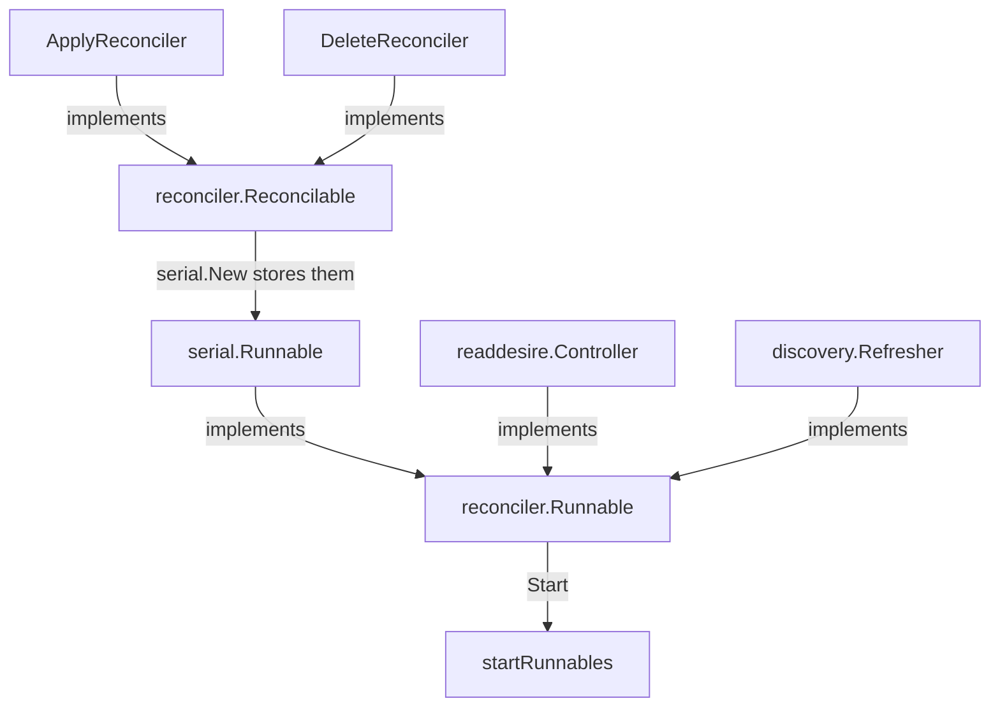

# internal/reconciler

`Runnable` and `Reconcilable` are the two lifecycles the applier starts.

`serial.New` returns `*serial.Runnable`. `readdesire.New` returns `*Controller`. `discovery.New` returns `*Refresher`. All three implement `Runnable`, and `startRunnables` calls `Start` on each. `serial.Runnable.Start` then calls `RunOnce` on apply, then delete.
